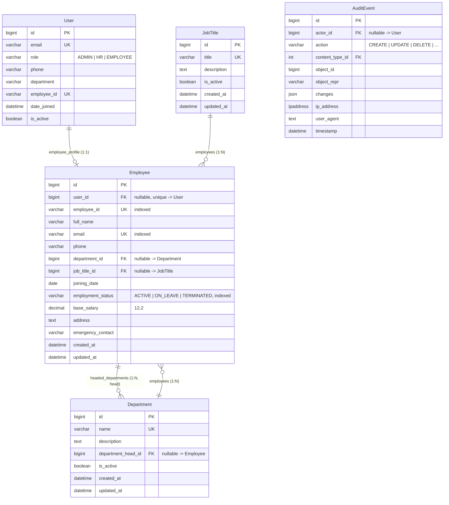

# M3: Employees & Departments ?" ER Diagram & Schema Specification (Week 1)

This document contains the Entity-Relationship (ER) diagram, schema definitions, integrity constraints, and architectural notes for the **Employees & Departments** domain (`apps.employees`).

---

## 1. Entity-Relationship Diagram

---

## 2. Model Specifications

### 2.1 `Department` (`apps.employees.models.Department`)

Represents organizational units (e.g., Engineering, Human Resources, Finance).

| Field Name | Type | Constraints / Attributes | Description |
|---|---|---|---|
| `id` | `BigAutoField` | PK, Auto | Primary key |
| `name` | `CharField(100)` | Unique, Required | Distinct department name |
| `description` | `TextField` | Blank | Operational scope and department summary |
| `department_head` | `ForeignKey('Employee')` | Nullable, Blank, `on_delete=SET_NULL`, `related_name='headed_departments'` | Designated department manager/lead |
| `is_active` | `BooleanField` | Default: `True` | Operational flag |
| `created_at` | `DateTimeField` | `auto_now_add=True` | Record creation timestamp |
| `updated_at` | `DateTimeField` | `auto_now=True` | Record update timestamp |

**Ordering:** `['name']`

---

### 2.2 `JobTitle` (`apps.employees.models.JobTitle`)

Represents professional designations and job roles.

| Field Name | Type | Constraints / Attributes | Description |
|---|---|---|---|
| `id` | `BigAutoField` | PK, Auto | Primary key |
| `title` | `CharField(100)` | Unique, Required | Position title (e.g., Senior Software Engineer) |
| `description` | `TextField` | Blank | Role responsibilities and requirements |
| `is_active` | `BooleanField` | Default: `True` | Active status flag |
| `created_at` | `DateTimeField` | `auto_now_add=True` | Record creation timestamp |
| `updated_at` | `DateTimeField` | `auto_now=True` | Record update timestamp |

**Ordering:** `['title']`

---

### 2.3 `Employee` (`apps.employees.models.Employee`)

Core organizational employee profile.

| Field Name | Type | Constraints / Attributes | Description |
|---|---|---|---|
| `id` | `BigAutoField` | PK, Auto | Primary key |
| `user` | `OneToOneField(AUTH_USER_MODEL)` | Nullable, Blank, Unique, `on_delete=SET_NULL`, `related_name='employee_profile'` | Link to authentication user |
| `employee_id` | `CharField(20)` | Unique, Indexed, Required | Unique organization identifier (e.g., `EMP001`) |
| `full_name` | `CharField(150)` | Required | Full legal name |
| `email` | `EmailField` | Unique, Indexed, Required | Official corporate email address |
| `phone` | `CharField(25)` | Blank | Primary contact phone number |
| `department` | `ForeignKey(Department)` | Nullable, Blank, `on_delete=PROTECT`, `related_name='employees'` | Assigned department |
| `job_title` | `ForeignKey(JobTitle)` | Nullable, Blank, `on_delete=PROTECT`, `related_name='employees'` | Assigned designation |
| `joining_date` | `DateField` | Required | Start date of employment |
| `employment_status`| `CharField(20)` | Choices (`ACTIVE`, `ON_LEAVE`, `TERMINATED`), Default: `ACTIVE`, Indexed | Current employment status |
| `base_salary` | `DecimalField(12, 2)` | Default: `0.00` | Monthly base salary in currency units |
| `address` | `TextField` | Blank | Residential/postal address |
| `emergency_contact`| `CharField(100)`| Blank | Emergency contact person and phone |
| `created_at` | `DateTimeField` | `auto_now_add=True` | Record creation timestamp |
| `updated_at` | `DateTimeField` | `auto_now=True` | Record update timestamp |

**Indexes:**
- `['employee_id']` (unique lookup index)
- `['email']` (unique lookup index)
- `['employment_status']` (filtering active vs. on-leave/terminated)
- `['department', 'employment_status']` (composite index for department headcount & status reporting)

**Ordering:** `['full_name']`

---

## 3. Key Relationships & Referential Integrity Rules

1. **User $\leftrightarrow$ Employee (`OneToOneField`, `on_delete=models.SET_NULL`)**:
   - Allows employees to exist prior to account provisioning (e.g., in pre-boarding).
   - Deleting a login account does not delete the employee's historical employment or payroll record (`SET_NULL`).
   - Reverse relation via `user.employee_profile`.

2. **Department $\leftrightarrow$ Employee (`ForeignKey`, `on_delete=models.PROTECT`)**:
   - Employees point to a `Department`.
   - `PROTECT` prevents deleting a department if employees are currently assigned to it, preserving organizational structure.

3. **JobTitle $\leftrightarrow$ Employee (`ForeignKey`, `on_delete=models.PROTECT`)**:
   - `PROTECT` prevents deleting a designation if employees currently hold that title.

4. **Department Head (`Department.department_head` $\rightarrow$ Employee, `on_delete=models.SET_NULL`)**:
   - Resolves circular dependency smoothly.
   - If the department head employee leaves or their record is removed, the department remains with `department_head = NULL`.

---

## 4. Business Logic & Methods

### 4.1 10-Point Profile Completeness Score (`calculate_profile_completeness`)
Computes an integer percentage `[0 - 100]%` based on 10 evaluated profile dimensions:
1. `full_name` is non-empty
2. `email` is non-empty
3. `phone` is non-empty
4. `department_id` is assigned
5. `job_title_id` is assigned
6. `joining_date` is set
7. `base_salary` $> 0.00$
8. `address` is non-empty
9. `emergency_contact` is non-empty
10. `user_id` (linked active login account)

### 4.2 Active Status Property (`is_active_employee`)
Returns `True` if `employment_status == EmploymentStatus.ACTIVE`.

---

## 5. Audit & Permissions Integration

- All three models (`Department`, `JobTitle`, `Employee`) inherit from `apps.accounts.mixins.AuditedModelMixin`.
- Custom `save()` and `delete()` support `audit_actor` and `audit_request` context propagation.
- Compatible with `apps.accounts.permissions` (`IsOwnerOrHR`, `IsSelfOrHR`, `CanAccessPayroll`) which inspect `hasattr(obj, 'user')` and `hasattr(obj, 'employee')`.
