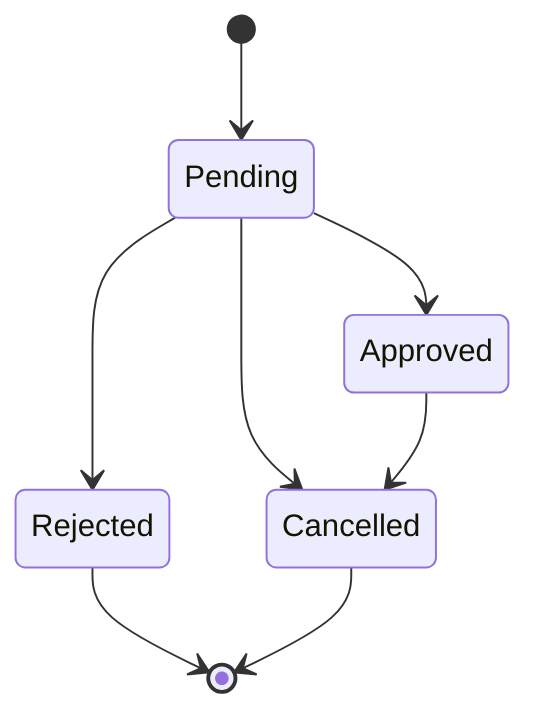

# Attendance & Leave Management: Rules Specification

| | |
|---|---|
| **Module** | Attendance & Leave (`apps/attendance/`, `apps/leave_management/`) |
| **Owner** | M4 |
| **Phase** | Weeks 1 and 2: Requirements, Rules and Workflows |
| **Status** | Draft, pending team lead review |

---

## 1. Purpose and Scope

This specification defines the business rules for the Attendance and Leave modules of the Smart HRMS: the status vocabularies, the permitted leave state transitions, the leave balance and duration rules, and the integrity and access constraints that the implementation must satisfy.

### 1.1 Conventions

| Label | Meaning |
|---|---|
| **Confirmed** | Stated in the project requirements or decided by the team lead. |
| **Proposed** | A recommendation by M4. Requires team lead approval before it becomes a rule. |
| **Open** | Not yet decided. No assumption has been made. |

The **Implemented** column shows whether the rule is enforced by the current code (service functions and database constraints).

---

## 2. Attendance Rules

### 2.1 Attendance Statuses (Confirmed)

| Status | Definition |
|---|---|
| `Present` | The employee is recorded as having attended on the given day. |
| `Absent` | The employee is not recorded as having attended on the given day. |
| `Late` | The employee attended, but after the expected start time. |
| `Half-day` | The employee is recorded as having worked a partial day. |
| `On-leave` | The employee is on leave on the given day. |

A check-in creates a record with status `Present`. The criteria for `Late`, `Half-day` and `On-leave` are not defined yet and are listed in Section 5.

### 2.2 Attendance Requirements

| ID | Requirement | Status | Implemented |
|---|---|---|---|
| ATT-01 | Employees can record check-in and check-out. | Confirmed | Yes |
| ATT-02 | At most one attendance record is permitted per employee per day. | Confirmed | Yes (service check and database constraint) |
| ATT-03 | Attendance corrections are limited to HR (the current code also admits Admin, see Section 5). | Confirmed | Yes |
| ATT-04 | Every attendance correction is audited. | Confirmed | Yes |
| ATT-05 | A monthly attendance summary is produced. | Confirmed | Yes |
| ATT-06 | A correction records who made the change, when, and the reason. | Proposed | Yes |
| ATT-07 | Employees can view only their own attendance; HR and Admin can view all records. | Proposed | No (no views yet) |
| ATT-08 | A correction requires a non-empty reason. | Proposed | Yes |
| ATT-09 | Only active employees can check in or check out. | Proposed | Yes |
| ATT-10 | Check-out must be later than check-in, and requires a prior check-in on the same day. | Proposed | Yes |

---

## 3. Leave Rules

### 3.1 Leave Statuses (Confirmed)

| Status | Definition |
|---|---|
| `Pending` | The request has been submitted and awaits a decision. |
| `Approved` | The request has been accepted. |
| `Rejected` | The request has been declined. |
| `Cancelled` | The request has been withdrawn. |

### 3.2 State Transitions (Confirmed)

Any transition not listed as permitted must be rejected with a validation error.

| From \ To | Pending | Approved | Rejected | Cancelled |
|---|:---:|:---:|:---:|:---:|
| **Pending** | n/a | Permitted | Permitted | Permitted |
| **Approved** | Denied | n/a | Denied | Permitted |
| **Rejected** | Denied | Denied | n/a | Denied |
| **Cancelled** | Denied | Denied | Denied | n/a |

`Rejected` and `Cancelled` are terminal states. `Approved` can only move to `Cancelled`, which restores the unused leave days to the balance (Section 3.4).

### 3.3 Leave Request Requirements

| ID | Requirement | Status | Implemented |
|---|---|---|---|
| LV-01 | Employees can apply for leave. | Confirmed | Yes |
| LV-02 | Leave can be approved or rejected with remarks, and cancelled. | Confirmed | Yes |
| LV-03 | A status history is retained for each leave request. | Confirmed | Yes |
| LV-04 | Invalid status transitions raise a validation error. | Confirmed | Yes |
| LV-05 | Overlapping leave dates are detected (against Pending and Approved requests of the same employee). | Confirmed | Yes |
| LV-06 | Leave balance is checked. | Confirmed | Yes (at approval, see LV-10) |
| LV-07 | A leave decision emits an event used for email notification. | Confirmed | No (planned for Week 3) |
| LV-08 | The end date must not precede the start date. | Proposed | Yes (service check and database constraint) |
| LV-09 | Each status change is recorded in the history with a timestamp and the acting user. | Proposed | Yes |
| LV-20 | Only HR or Admin can approve or reject a request, and nobody can approve or reject their own request. | Proposed | Yes |
| LV-21 | Remarks are required to approve or reject. Cancelling does not require remarks. | Proposed | Yes |
| LV-22 | Cancelling a request does not change the recorded approver or the approver remarks. | Proposed | Yes |

### 3.4 Leave Balance and Duration Rules

| ID | Rule | Status | Implemented |
|---|---|---|---|
| LV-10 | The balance is deducted when a request is approved. Pending requests do not affect the balance. | Confirmed | Yes |
| LV-11 | Rejected requests, and requests cancelled before approval, do not affect the balance. | Confirmed | Yes |
| LV-12 | Cancelling an approved request restores the eligible unused working days. | Confirmed | Yes |
| LV-13 | If leave is cancelled before it starts, all approved days are restored. If it is partly taken, only the unused working days are restored, using attendance records. | Confirmed | Yes |
| LV-14 | If attendance data is missing or unclear, the balance is not restored automatically and the request is flagged for HR review. | Confirmed | Yes |
| LV-15 | The leave year is the calendar year. A request spanning two years is calculated and deducted separately for each year. | Confirmed | Yes |
| LV-16 | Weekends and configured public holidays are excluded from leave duration. | Confirmed | Yes (Monday to Friday working week) |
| LV-17 | Insufficient balance results in rejection of the request. A multi-year request deducts nothing unless every year has enough balance. | Confirmed | Yes |
| LV-18 | Only HR and Admin manage leave balances, quotas and manual adjustments. | Confirmed | Partly (Django admin only; no dedicated workflow) |
| LV-19 | Quotas are configurable per leave type. Unused leave may be carried forward up to a configurable limit. | Confirmed | No |
| LV-23 | A balance is restored at most once, and never partially across years. | Proposed | Yes |

---

## 4. Data Integrity and Access Control

### 4.1 Confirmed

- Authentication and least-privilege authorization apply to every protected operation, and access boundaries are tested explicitly.
- Attendance corrections are restricted to HR and are audited.
- Invalid leave transitions are rejected with a validation error.
- Only HR and Admin manage leave balances.

### 4.2 Enforced by the database

| Rule | Where |
|---|---|
| One attendance record per employee per date | `Attendance` unique constraint |
| Check-out later than check-in | `Attendance` check constraint |
| Leave end date not before start date | `LeaveRequest` check constraint |
| One balance per employee, leave type and year | `LeaveBalance` unique constraint |
| One public holiday per date | `PublicHoliday` unique field |
| Status values limited to fixed choices | All status fields |

### 4.3 Proposed

- All validation is enforced on the server side; client-side checks are advisory only.
- Status changes go through a single service function, so no code path bypasses the transition rules.
- Records are not hard-deleted: employees, leave types and leave requests that have records cannot be deleted. History is retained.
- Changes made through Django admin do not pass through these rules. Admin is for viewing and for creating test data and balances.

---

## 5. Open Items for Team Lead Decision

| # | Question |
|---|---|
| 1 | What criteria set `Late` and `Half-day`? |
| 2 | How is `On-leave` assigned: automatically when leave is approved, or manually? Nothing currently creates `On-leave` records, so restoration for leave that has already started will usually go to HR review. |
| 3 | Who may cancel an approved request: the employee, HR, or both? |
| 4 | Attendance corrections are "HR only", but the `IsHR` permission also admits Admin. May Admin also correct attendance? |
| 5 | Which audit action is recorded for a leave cancellation, since `AuditEvent` defines no cancel action? |
| 6 | What are the quota values per leave type, the carry-forward limit, and the process for annual quota reset? |
| 7 | Should `Employee.employment_status` change to `On Leave` when leave is approved, and who updates it? |
| 8 | Confirm that HR and Admin may approve and reject leave (currently implemented). |
| 9 | Is a specific format required for the monthly attendance summary? |
